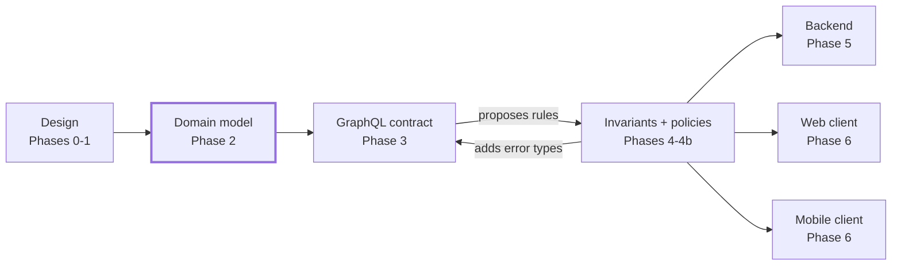

# Design-Anchored Development (DAD)

**An AI-assisted methodology where the UX design is the entry point, the domain model is the hub, and one GraphQL contract plus documented invariants and policies generate the backend and every frontend.**

Most AI coding workflows start from a written prompt or spec, and the agent guesses everything text leaves out. A finished UX design is the most concrete description of a product that exists before code. DAD turns it into a chain of small, reviewable, machine-readable artifacts, with a human checkpoint after each one.



Once the domain, contract, invariants and policies exist, a second client (mobile, admin, partner) is mostly a generation step. It still needs its own design, but inherits every data shape and every business rule.

## The phases

| Phase | Output | Human checkpoint |
| --- | --- | --- |
| 0 · Design conventions | A design file that follows [the checklist](templates/dad/design/checklist.md) | Designer + engineer sign off; Figma lint passes |
| 1 · Design extraction | `inventory.md`, `open-questions.md` | Every question answered |
| 2 · Domain model | `domain.md` | Domain expert validates |
| 3 · GraphQL contract | `schema.graphql`, one operation per screen | Engineer reviews |
| 4 · Invariants | `invariants.yaml`, error types in the schema | Domain expert signs off |
| 4b · Policies | `policies.yaml` | Domain expert + security sign off |
| 5 · Backend | API + one test per rule ID | Green suite |
| 6 · N clients | Each client from the same contract | Review against its design |

Read the full methodology in **[docs/methodology.md](docs/methodology.md)**.

## What makes it different

- **Design first, not spec first.** The agent reads a design built to be read (realistic data, `@Entity.field` layer names, every state drawn, rules annotated) and writes questions instead of guessing.
- **The domain is the hub.** The API is derived from the domain, not from screens, so it survives redesigns and new clients.
- **Rules have IDs.** Every business rule (`INV-*`) and permission (`POL-*`) is a YAML entry with an error type in the schema and a test named after it. "Is this rule enforced?" becomes a search.
- **Checked in CI.** [`dad-check`](scripts/dad-check.mjs) fails the build when a rule points to a missing error type, a policy targets a missing operation, a screen's query does not validate, or a rule has no test.

It builds on [GitHub Spec Kit](https://github.com/github/spec-kit), Domain-Driven Design, contract-first APIs and consumer-driven contracts; the [positioning table](docs/methodology.md#prior-art-and-positioning) explains what DAD takes from each and what it adds.

## Quick start

With [Claude Code](https://claude.com/claude-code), copy `.claude/commands/` into your project (or clone this repo next to it) and run:

```text
/dad-init                       set up ./dad from the templates
/dad-extract <figma link>       Phase 1
/dad-domain                     Phase 2
/dad-contract                   Phase 3
/dad-invariants                 Phase 4
/dad-policies                   Phase 4b
/dad-backend                    Phase 5
/dad-client web <design link>   Phase 6, repeat per client
```

Any other agent works too: the commands are plain Markdown prompts, and `dad/rules.md` holds the rules every phase follows.

Run the consistency check:

```bash
npm install
npx dad-check --dad dad --tests apps/api
```

## Example

[`examples/loans`](examples/loans) walks a small lending app through Phases 1 to 5: inventory with answered questions, domain model with a loan state machine, GraphQL schema with typed error unions, 6 invariants, 7 policies, per-screen operations and the rule-ID test list.

```bash
npm run check:example
# DAD check: 6 invariants, 7 policies, 0 errors, 0 warnings
```

## Repository layout

```text
docs/methodology.md     the full methodology
templates/dad/          the artifacts to copy into a project
schemas/                JSON Schemas for invariants.yaml and policies.yaml
scripts/dad-check.mjs   consistency check for CI
.claude/commands/       one agent command per phase
examples/loans/         worked example
```

## Status

v0.1, early and opinionated. See the [roadmap](docs/methodology.md#decisions-and-roadmap). Feedback and real-world reports are welcome in [issues](../../issues); see [CONTRIBUTING.md](CONTRIBUTING.md).

## License

[MIT](LICENSE) © 2026 Sergio Montaño
