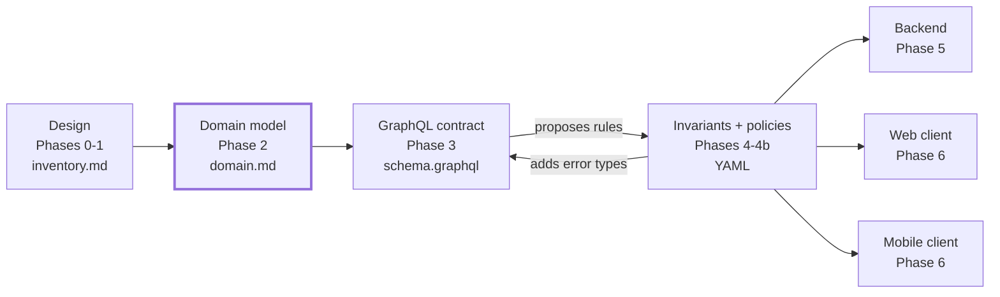

# Design-Anchored Development (DAD)

*Methodology v0.1 · Sergio Montaño*

## Overview

Design-Anchored Development (DAD) is an AI-assisted methodology where the UX design is the entry point, the domain model is the hub, and the GraphQL contract plus documented invariants and policies are the single source of truth that every backend and frontend is generated from.

Most AI coding workflows start from a written prompt or spec. Text is ambiguous: the agent has to guess layouts, states, data shapes and rules, and those guesses compound across layers. A finished UX design is the most concrete description of a product that exists before code. It shows real data, real states and real flows.

DAD turns that design into a chain of small, reviewable, machine-readable artifacts. Each phase has one job, one output file and one human checkpoint:

1. **Design** shows what the user needs to see and do.
2. **Domain** names the entities, states and relationships behind it, independent of any screen.
3. **Contract** exposes the domain as an API.
4. **Invariants** capture the business rules the screens cannot show, and **policies** capture who is allowed to do what; both carry IDs and error codes.
5. **Code** is generated from contract + invariants + policies: one backend, and as many frontends as you need.

The core claim: once the domain, contract and invariants exist, a second client (a mobile app, an admin panel, a partner integration) is mostly a generation step, not a new project. It still needs its own design, but it inherits every data shape and every rule for free.

## The pipeline at a glance



Artifacts flow one way, from design to code, except for one loop: invariants add error types back to the schema until both agree. Adding a client means adding a box at the bottom, not a new pipeline.

## Prior art and positioning

DAD is a composition of proven ideas, plus three things none of them formalize: a design-first entry point, a project-level domain hub, and generation of many clients from one contract.

| Approach | What DAD takes from it | What DAD adds |
| --- | --- | --- |
| [GitHub Spec Kit](https://github.com/github/spec-kit) | Phased artifacts with human checkpoints; `data-model.md` and `contracts/` generated before code; a project-level rules file (`constitution.md`) | Starts from the UX design instead of a written spec; the domain model lives across features instead of per feature; dedicated invariants and policies artifacts with traceable IDs |
| Domain-Driven Design | Entities, aggregates, ubiquitous language, the domain as the center | A lightweight, agent-readable format; the domain is discovered from the design, then validated by humans |
| Contract-first / API design-first | The contract is written before the implementation and is the source of truth | The contract is derived from the domain, not hand-written, and is fed back by the invariants phase |
| Consumer-driven contracts (e.g. Pact) | Consumers declare what they need; providers are verified against it | Many consumers generated from one contract, each inheriting the same rules |
| Outside-in development | Start from what the user sees and work inward | Uses AI for the translations between layers, with a checkpoint at each one |

A known critique of Spec Kit is that it is spec-first but not spec-anchored over time: specs are written per feature and drift afterwards. DAD's answer is that `domain.md`, the schema, `invariants.yaml` and `policies.yaml` are living, project-level files that every change updates.

## Phase 0: Design conventions

An agent can read a Figma file, but it reads what is there, not what the designer meant. A file with layers named `Frame 427`, lorem ipsum and only the happy path forces the agent to guess, and it guesses wrong on exactly what matters: what is dynamic data and which states exist. These conventions close that gap.

**Output:** a design file that follows the conventions below. **Checkpoint:** a designer and an engineer agree the file is ready for extraction.

| Convention | Example | Why the agent needs it |
| --- | --- | --- |
| Realistic data, never lorem ipsum | `$12,500.00 MXN`, `Due Oct 30, 2026` | Reveals types, formats, currency and precision |
| Dynamic layers named after the entity field | `@Loan.amount`, `@User.fullName` | Turns domain extraction from inference into reading |
| Every state designed, not just the happy path | Empty, loading, error, and one frame per entity state | Each entity state is a hint of a state machine in the domain |
| Components with variants | `LoanBadge / status=approved` | Variants map almost one to one to enums and states |
| Annotations for rules the screen cannot show | "Button visible only when balance is 0" | Annotations are invariants in disguise |
| Connected flows (prototype links) | List → detail → confirm → success | Transitions between screens reveal actions and mutations |
| Static copy marked as static | Prefix `#static` on fixed labels | Prevents the agent from modeling marketing text as data |

The conventions also help the designer: they force thinking about states and rules that usually surface late, during development.

**Enforcement:** Phase 0 is a human checklist owned by the designer ([`templates/dad/design/checklist.md`](../templates/dad/design/checklist.md)), one of the few deliberately human steps in DAD. A Figma lint plugin then verifies the mechanical parts (layer naming, no lorem ipsum, required state frames per component) before Phase 1 runs, so the agent never starts from a file that fails the checklist.

## Phase 1: Design extraction

The agent reads the design (through the Figma MCP server, exported frames or screenshots) and produces a structured inventory of what each screen shows and does, plus a list of everything it could not resolve.

**Input:** the design file. **Output:** `design/inventory.md` and `design/open-questions.md`. **Checkpoint:** every open question is answered or explicitly deferred.

The inventory lists, per screen:

- Dynamic fields, with the `@Entity.field` they map to and an example value
- States shown (empty, loading, error, entity states)
- User actions (buttons, forms, gestures) and where each leads
- Annotated conditions and rules

**The most important rule of this phase:** when something is ambiguous, the agent writes a question instead of guessing. A wrong assumption here propagates into the domain, the contract, the invariants and every generated client. The open-questions file is what keeps the whole pipeline honest.

```markdown
### Q-007 · LoanDetail screen
The "Pay now" button appears in the approved and disbursed frames.
Is paying allowed while the loan is only approved (not yet disbursed)?
Blocks: domain state machine for Loan
```

## Phase 2: Domain model

The agent turns the inventory into `domain.md`: the entities, their fields, relationships and state machines, described in business language with no reference to any screen or endpoint. This is the hub of the methodology.

**Input:** `design/inventory.md`, answered open questions. **Output:** `domain/domain.md`. **Checkpoint:** a domain expert (product, operations, business) validates it.

Why this phase exists: deriving an API straight from screens produces operations coupled to the UI (`getHomeScreenData`). When the design changes or a second client arrives, that API breaks or gets duplicated. Extracting the domain first means the screens are one consumer of the model, not its owner.

The design reveals what data is needed, but not everything the business knows. Human validation here is mandatory, not optional.

```markdown
## Loan
A sum lent to a Borrower, repaid in Installments.

| Field | Type | Notes |
| --- | --- | --- |
| id | UUID | |
| borrowerId | UUID | → Borrower |
| principal | Money | MXN, 2 decimals |
| pendingBalance | Money | derived from Installments |
| status | LoanStatus | see state machine |

### State machine: LoanStatus
requested → approved → disbursed → liquidated
requested → rejected

### Glossary
- Liquidated: fully repaid, no pending balance.
```

## Phase 3: GraphQL contract

The agent generates the GraphQL schema from `domain.md`, using the design inventory only to confirm every screen can be served by a query.

**Input:** `domain/domain.md`, `design/inventory.md`. **Output:** `contracts/schema.graphql`. **Checkpoint:** an engineer reviews type design, naming, pagination and nullability.

Why GraphQL from v0.1: each client asks for exactly the fields its screens need, so N frontends share one schema without the backend adding screen-specific endpoints. That removes most of the pressure toward a BFF and serves the methodology's core claim directly.

Rules for this phase:

- Types are named after domain entities (`Loan`, `Installment`), never after screens; mutations use domain verbs (`approveLoan`, `liquidateLoan`).
- Every field, enum and state comes from `domain.md`. A field the domain lacks is a domain change first, then a schema change.
- Coverage check: the agent writes one GraphQL operation per screen (`operations/<client>/*.graphql`) and validates it against the schema. A screen whose operation does not validate is reported, not patched.
- Business errors are typed, not HTTP status codes: each mutation returns a result union (`LiquidateLoanResult = Loan | LoanHasPendingBalance`). The convention is fixed in `rules.md` and used everywhere.
- Nullability is a contract decision: a field is nullable only when the domain says it can be absent.

From this point a mock server (Apollo Server mocks, GraphQL Faker) can serve the schema and GraphQL Code Generator can produce typed clients, so frontend work starts before the backend exists.

## Phase 4: Invariants

The agent proposes the invariants implied by the contract and the domain, humans complete and validate them, and every invariant that can fail adds an error type back to the schema.

**Input:** `domain/domain.md`, `contracts/schema.graphql`, design annotations. **Output:** `domain/invariants.yaml` and an updated schema. **Checkpoint:** a domain expert signs off on the rule list.

The contract only gives half of the rules. Structural invariants (required fields, enums, ranges, formats) can be inferred from it. Business invariants ("a loan cannot be liquidated with a pending balance", "status never moves from disbursed back to approved") live in the domain and in people's heads, so the agent proposes and humans complete.

Each invariant is a YAML entry with a stable ID, validated in CI against a JSON Schema ([`schemas/invariants.schema.json`](../schemas/invariants.schema.json)). YAML wins over Markdown here because generators and the CI cross-reference script parse it without guessing, and a malformed rule fails fast instead of producing wrong code. The `rule` field stays in plain language so domain experts can still review it.

```yaml
- id: INV-LOAN-003
  entity: Loan
  kind: state_transition
  rule: Cannot move to liquidated while pendingBalance > 0
  enforced_in:
    backend: mandatory
    frontend: ux_only
  error:
    code: LOAN_HAS_PENDING_BALANCE
    graphql_type: LoanHasPendingBalance
  examples:
    valid:   { pendingBalance: 0, transition: "disbursed -> liquidated" }
    invalid: { pendingBalance: 150.00, transition: "disbursed -> liquidated" }
```

**The feedback loop:** each error named in an invariant must exist in the schema. If `INV-LOAN-003` names `LOAN_HAS_PENDING_BALANCE`, the agent adds `LoanHasPendingBalance` to the `liquidateLoan` result union. Contract → invariants → contract is the only loop in the pipeline, and it runs until no invariant references an error the schema lacks.

## Phase 4b: Policies

Policies define who is allowed to do what: which role can run each mutation and which records each role can see. They live in `domain/policies.yaml`, separate from invariants, because an invariant holds for everyone while a policy depends on who is asking.

**Input:** `domain/domain.md` (actors and roles), `contracts/schema.graphql`. **Output:** `domain/policies.yaml`. **Checkpoint:** a domain expert and the security owner sign off.

| | Invariant | Policy |
| --- | --- | --- |
| Question it answers | Is this operation valid? | Is this caller allowed? |
| Depends on the caller | No | Yes |
| Example | A loan with pending balance cannot be liquidated | Only an operations analyst can approve a loan; a borrower sees only their own loans |
| Error | Business error (`LoanHasPendingBalance`) | `NotAuthorized` |

```yaml
- id: POL-LOAN-002
  action: mutation.approveLoan
  allow: [ops_analyst, ops_manager]
  error: { code: NOT_AUTHORIZED, graphql_type: NotAuthorized }
- id: POL-LOAN-005
  action: query.loans
  allow: [borrower]
  scope: loan.borrowerId == viewer.id
```

Policies follow the same rules as invariants: every policy gets a backend test named after its ID, and clients use them only to hide or disable actions, never as the real check.

## Phase 5: Backend and tests

The backend is generated from the contract, the invariants and the policies, tests first: every operation gets contract tests, and every invariant and policy gets at least one test named after its ID.

**Input:** `contracts/schema.graphql`, `domain/invariants.yaml`, `domain/policies.yaml`, `rules.md`. **Output:** backend code and test suite. **Checkpoint:** code review plus a green suite.

Order of work for the agent:

1. Generate resolver types from the schema (GraphQL Code Generator).
2. Write one failing test per invariant and per policy: `it('INV-LOAN-003: rejects liquidation with pending balance')`.
3. Write contract tests that verify every response matches the schema, error types included.
4. Implement until all tests pass.
5. Report coverage by invariant and policy ID: any rule without a passing test blocks the phase.

Because tests carry rule IDs, "is this business rule enforced?" becomes a search, not an investigation.

## Phase 6: N frontends from the same contract

Every client (web, mobile, admin) is generated from the same contract, invariants and policies, so each one inherits the same data shapes and the same business rules without anyone re-explaining them.

**Input:** `contracts/schema.graphql`, `domain/invariants.yaml`, `domain/policies.yaml`, that client's own design. **Output:** a client app. **Checkpoint:** review against the client's design and a run against the mock or real API.

What is generated vs what still needs a human:

| Layer | Generated from contract + invariants + policies | Needs its own work |
| --- | --- | --- |
| Data | Typed operations and hooks (GraphQL Code Generator), normalized cache setup | Nothing |
| Rules | Client-side validation, actions hidden by policy, error type → message mapping | Wording of messages per platform |
| UX | Nothing | The client's own design, following Phase 0 conventions |

The contract tells a new client what data exists and which rules apply, not how to present it. A mobile app still needs a mobile design.

**Design validation for new clients:** when a new client's design arrives, the agent runs Phase 1 on it and diffs the inventory against `domain.md`. The result is either "fully served by the existing contract" or a precise list of domain gaps. That is the reverse direction of the pipeline: domain → new design check → generated client.

## Repository structure

All DAD artifacts live in a `dad/` folder at the repo root, versioned with the code, so a pull request that changes a rule shows the rule, the contract and the tests changing together.

```text
dad/
├── rules.md                 # agent rules for every phase
├── design/
│   ├── checklist.md         # Phase 0, human checklist for designers
│   ├── inventory.md         # Phase 1 output
│   └── open-questions.md    # Phase 1 output
├── domain/
│   ├── domain.md            # Phase 2, the hub
│   ├── invariants.yaml      # Phase 4
│   └── policies.yaml        # Phase 4b
└── contracts/
    ├── schema.graphql       # Phase 3, updated by Phase 4
    └── operations/          # one .graphql per screen, per client
apps/
├── api/                     # Phase 5
├── web/                     # Phase 6
└── mobile/                  # Phase 6
```

| File | Owner | Changes when |
| --- | --- | --- |
| `rules.md` | Tech lead | The team changes how agents should work |
| `checklist.md` | Designer | The design conventions change |
| `domain.md` | Domain expert + tech lead | The business changes |
| `invariants.yaml` | Domain expert | A rule is added, changed or removed |
| `policies.yaml` | Domain expert + security owner | A role or permission changes |
| `schema.graphql` | Tech lead | The domain, an invariant or a policy changes |
| `inventory.md` | Agent, reviewed by designer | The design changes |

## Agent rules (rules.md)

`rules.md` is loaded by the agent at the start of every phase; it holds the rules that keep the pipeline consistent regardless of which tool or model runs it. The starter set lives in [`templates/dad/rules.md`](../templates/dad/rules.md):

1. **Never guess.** Ambiguity becomes an entry in `open-questions.md`, never an assumption in code.
2. **Stay in your phase.** Each phase reads its declared inputs and writes only its declared outputs.
3. **Upstream first.** A change needed downstream (a new field in a client) is made in the earliest artifact that owns it (`domain.md`), then propagated.
4. **Domain language only.** Names come from the domain glossary; no screen names in the domain or the schema.
5. **Every rule has an ID.** Business rules exist only in `invariants.yaml`, permissions only in `policies.yaml`; code and tests reference them by ID.
6. **Every error is in the schema.** No server returns, and no client handles, an error type the schema does not declare.
7. **Stop at checkpoints.** The agent does not start the next phase until the human checkpoint for the current one is recorded.

The file is meant to be extended per project: stack choices, naming conventions, testing frameworks.

## Traceability and change management

Stable IDs (`@Entity.field` in the design, `INV-*` for rules, `POL-*` for permissions, `Q-*` for questions) let anyone trace a business rule from the design annotation to the test that enforces it and the screens that show it.

A change always enters at the earliest artifact that owns it and flows downstream:

| Change | Enters at | Then updates |
| --- | --- | --- |
| New screen or redesign | Design → inventory | Domain only if the diff shows gaps |
| New business rule | `invariants.yaml` | Schema error types, backend test, client validation |
| New role or permission | `policies.yaml` | Backend test, actions hidden in clients |
| New field | `domain.md` | Schema, invariants if constrained, clients |
| New client (e.g. mobile) | Its own design | Inventory diff against domain; usually nothing upstream |

In review, a pull request that adds an invariant without a matching test, or a schema error without a matching invariant, is incomplete by definition. Both checks are automated by [`scripts/dad-check.mjs`](../scripts/dad-check.mjs).

## Decisions and roadmap

Decisions for v0.1 (2026-10-21):

| Question | Decision |
| --- | --- |
| Name | Design-Anchored Development (DAD). No existing method uses it; the nearest, "Design-Driven Development", is a design-process practice unrelated to AI agents |
| API style | GraphQL from v0.1 |
| Phase 0 enforcement | Human checklist, verified by a Figma lint plugin |
| Invariants format | YAML, validated by JSON Schema |
| Authorization | Separate `policies.yaml` (Phase 4b) |

Roadmap to v0.1:

- [x] Templates for every artifact in `dad/`
- [x] JSON Schemas for `invariants.yaml` and `policies.yaml`
- [x] One agent command per phase (Claude Code first)
- [x] ID cross-reference script for CI
- [ ] Figma lint plugin for the mechanical Phase 0 checks
- [ ] Example repo: loans domain artifacts (done), backend, web client, then a mobile client generated from the same schema
- [ ] Launch articles in English and Spanish
